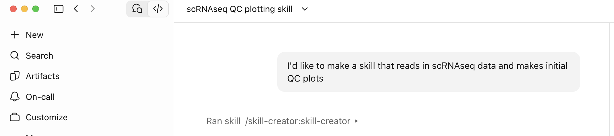
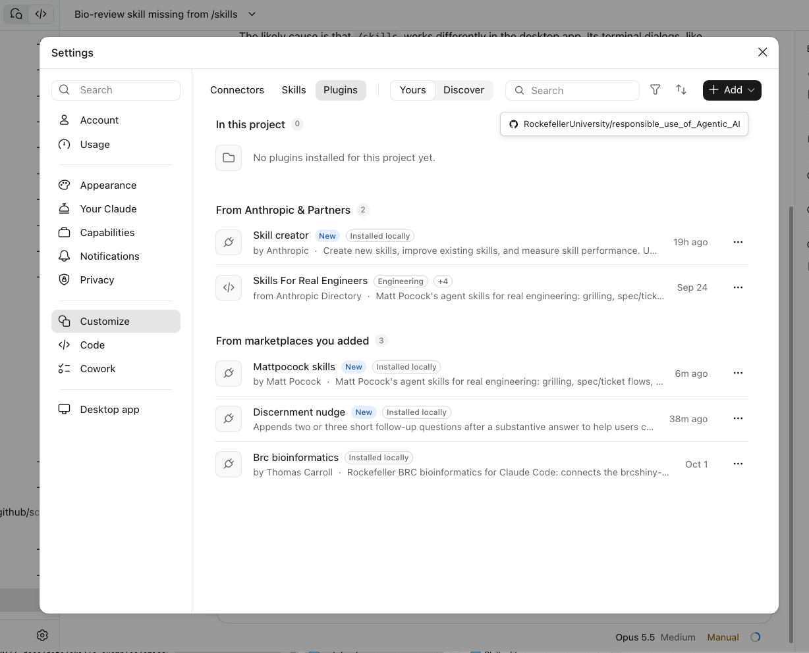
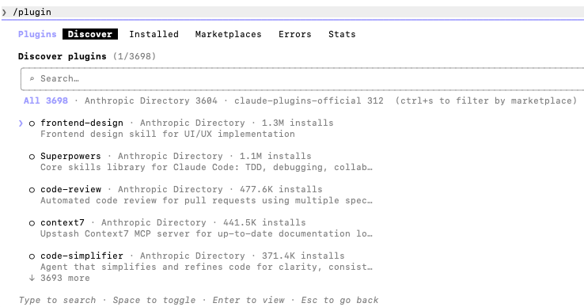

```{r setup, include=FALSE, purl=FALSE}
suppressPackageStartupMessages(require(knitr))
knitr::opts_chunk$set(echo = TRUE, tidy = T)
```

::: {.content-hidden when-format="revealjs"}
# Responsible Use of AI for Coders: Skills
:::

## Overview

- [What is a skill? Why use them?](#what-is-a-skill)
- [SKILL components](#skill-components)
- [Developing your own skills](#developing-skills)
- [Installing skills from public sources](#installing-skills)


# What is a skill? Why use them? {#what-is-a-skill .center .middle background-color="#23373B"}

## Built-in Slash commands {.smaller}

Agent harnesses such as Claude Code/Codex/Opencode have built-in commands which we can use to control our sessions.

The names differ between tools, but the ideas are the same.

| What it does | Claude Code | Codex | opencode |
|---|---|---|---|
| Summarise the conversation to free up context | `/compact` | `/compact` | `/compact` |
| Ask a quick side question without adding it to the conversation | `/btw` | `/side` (or `/btw`) | `/btw` |
| Go back to an earlier point (conversation and/or files) | `/rewind` | `Esc Esc` (edit last message, fork from there) | `/undo`, `/redo` |
| Plan first, change nothing until you approve | `/plan` | `/plan` | `Tab` (switch to Plan agent) |
| Share or view outputs outside the terminal | `/artifacts` | `/app` (open in desktop app, which previews files) | `/share` (link to the session) |

Type `/` in any of them to see the full list for your version.

::::: {.content-visible when-format="revealjs"}
::: notes
Commands change between versions; checked November 2026. opencode's /undo and /redo need the project to be a git repository. Codex's /side opens a temporary side chat (/btw is an alias); opencode's built-in /btw is in recent versions, older ones need a plugin.
:::
:::::


## Skills

Like these commands, skills can also be explicitly invoked with the forward slash (`/skill-name`) 

They are different in a few key and very useful ways:

- can be called explicitly by you or **passively by the model after a prompt.**
- allow for a high level of customization.
- are portable so they can easily be shared.

## Skills help with reproducibility 

Developing useful and well-designed skills can help your workflows be more efficient and reproducible. 

- skills promote consistency across analyses
  - when you ask the model to do something, it does what you expect every time
- they allow for shorter prompts without need for specific details
- can be shared between people, providing standards within a lab, team, or between collaborators

## Skills are universal

The skills format was initially developed by Anthropic, but now is an open standard and widely used by most models.

There will be slight differences between models that we will mention, but the concept is the same. The accepted specifications reference is here: [https://agentskills.io](https://agentskills.io).

## Skill directory

A skill is simply a directory on your computer at a specific location that the model is aware of. 

  - the *SKILL.md* file is the only required file in the skills directory.
  
```{.text code-line-numbers="false"}
My_favorite_Skill/
├── SKILL.md          # Required: metadata + instructions
├── scripts/          # Optional: executable code
├── references/       # Optional: documentation
├── assets/           # Optional: templates, resources
└── ...               # Any additional files or directories
```

## Skill scope

The location of this folder will determine where that skill is available.

::: {.columns}

::: {.column width="60%"}

  - for global skills, with claude this will be located at *~/.claude/skills*
  - this will be slightly different for other models (e.g. *~/.codex/skills/*)
  - skills can be limited to specific projects by placing them in a *.claude* or *.codex* directory within that project

:::

::: {.column width="40%"}
```{=html}
<style>
  .scope-wrap {
    --glob-bg:#d6e8fa; --glob-border:#7ab4e8; --glob-fg:#1a3d6b; --glob-label:#3a6ea5;
    --proj-bg:#e8daf7; --proj-border:#a97de0; --proj-fg:#4a1e8a; --proj-label:#6b30b8;
    --frame:#2f3b45; --muted:#6f7a83;
    font-family:'Inter', system-ui, sans-serif;
    display:flex; flex-direction:column; align-items:center; padding:0.25rem 0 0.5rem;
  }
  .scope-screen {
    width:100%; max-width:470px; box-sizing:border-box; background:var(--glob-bg);
    border:10px solid var(--frame); border-radius:14px 14px 4px 4px; padding:0.8rem 0.9rem 0.95rem;
    box-shadow:inset 0 0 0 2px var(--glob-border);
  }
  .scope-base {
    width:100%; max-width:530px; height:14px; background:var(--frame);
    border-radius:2px 2px 14px 14px; position:relative;
  }
  .scope-base::after {
    content:""; position:absolute; left:50%; top:0; transform:translateX(-50%);
    width:70px; height:5px; background:#4b5862; border-radius:0 0 6px 6px;
  }
  .scope-label {
    font-size:0.6rem; font-weight:700; letter-spacing:0.1em; text-transform:uppercase;
    color:var(--glob-label); margin-bottom:0.4rem;
  }
  .scope-global-head { margin-bottom:0.9rem; }
  .scope-project {
    background:var(--proj-bg); border:2px solid var(--proj-border); border-radius:12px;
    padding:0.6rem 0.75rem 0.7rem; margin:0.35rem 0 0.35rem 1.1rem;
  }
  .scope-row {
    display:flex; align-items:center; gap:0.4rem;
    font-family:ui-monospace, Menlo, Consolas, monospace; font-size:0.78rem; font-weight:600;
  }
  .scope-row svg { flex:none; width:1.05rem; height:1.05rem; }
  .scope-global-head .scope-row { color:var(--glob-fg); }
  .scope-project .scope-row     { color:var(--proj-fg); }
  .scope-indent { margin-left:1.1rem; margin-top:0.3rem; }
  .scope-pill {
    display:inline-block; margin-top:0.45rem; background:#fff; border:1px solid;
    border-radius:999px; padding:0.15rem 0.6rem; font-size:0.68rem; font-weight:600;
  }
  .scope-global-head .scope-pill { color:var(--glob-label); border-color:var(--glob-border); }
  .scope-project .scope-pill     { color:var(--proj-label); border-color:var(--proj-border); }
  .scope-plain { color:#3c464e; }
  .scope-other { color:var(--muted); margin-left:1.1rem; }
  .scope-note  { font-family:'Inter', system-ui, sans-serif; font-size:0.66rem; font-weight:500; font-style:italic; }
</style>

<div class="scope-wrap">
  <div class="scope-screen">
    <div class="scope-global-head">
      <div class="scope-label">Your computer</div>
      <div class="scope-row">
        <svg viewBox="0 0 24 24"><path fill="currentColor" d="M3 6a2 2 0 0 1 2-2h4.2l2 2H19a2 2 0 0 1 2 2v9a2 2 0 0 1-2 2H5a2 2 0 0 1-2-2z"/></svg>
        ~/.claude/skills/
      </div>
      <span class="scope-pill">Global: available everywhere on this computer</span>
    </div>

    <div class="scope-row scope-plain">
      <svg viewBox="0 0 24 24"><path fill="currentColor" d="M3 6a2 2 0 0 1 2-2h4.2l2 2H19a2 2 0 0 1 2 2v9a2 2 0 0 1-2 2H5a2 2 0 0 1-2-2z"/></svg>
      ~/Documents/
    </div>

    <div class="scope-project">
      <div class="scope-row">
        <svg viewBox="0 0 24 24"><path fill="currentColor" d="M3 6a2 2 0 0 1 2-2h4.2l2 2H19a2 2 0 0 1 2 2v9a2 2 0 0 1-2 2H5a2 2 0 0 1-2-2z"/></svg>
        project/
      </div>
      <div class="scope-row scope-indent">
        <svg viewBox="0 0 24 24"><path fill="currentColor" d="M3 6a2 2 0 0 1 2-2h4.2l2 2H19a2 2 0 0 1 2 2v9a2 2 0 0 1-2 2H5a2 2 0 0 1-2-2z"/></svg>
        .claude/skills/
      </div>
      <span class="scope-pill">Project: global + project skills</span>
    </div>

    <div class="scope-row scope-other">
      <svg viewBox="0 0 24 24"><path fill="currentColor" d="M3 6a2 2 0 0 1 2-2h4.2l2 2H19a2 2 0 0 1 2 2v9a2 2 0 0 1-2 2H5a2 2 0 0 1-2-2z"/></svg>
      other-project/ <span class="scope-note">&nbsp;global skills only</span>
    </div>
  </div>
  <div class="scope-base"></div>
</div>
```
:::

:::

# SKILL components {#skill-components .center .middle background-color="#23373B"}

## SKILL.md file - YAML header

The required *SKILL.md* file needs a YAML header and must have the `name` and `description` fields.

  - **name:** can only contain lower case letters, numbers, and hyphens (no hyphens at the beginning or end of the name)
  - **description:** max of 1024 characters outlining what this skill does and *when the model should use it.**
  - the agent uses both of these fields when deciding to activate the skill, but the description is the most important
  

```{.yaml filename="SKILL.md"}
---
name: bioinformatics-skill
description: What does this skill do? When should it be used?
---

```

[See an example SKILL.md](https://github.com/RockefellerUniversity/responsible_use_of_Agentic_AI/tree/master/docs/data/skills_examples/gene-summary/SKILL.md){target="_blank"}

## SKILL.md file - Body section

After the metadata header, the rest of the SKILL.md file is markdown-formatted text providing instructions to the model. 

This can take many forms, but it might include:

- steps in a workflow
- expected inputs and outputs
- common problems to avoid
- when to access scripts or files within skills folder

It is recommended to keep the SKILL.md file below 500 lines (~5k tokens), and more details or code templates can be selectively read from the *references* or *assets* folders.


[See an example SKILL.md](https://github.com/RockefellerUniversity/responsible_use_of_Agentic_AI/tree/master/docs/data/skills_examples/gene-summary/SKILL.md){target="_blank"}

## Minimizing tokens with 'progressive disclosure'

Skills are loaded and read into context in three steps:

- **Discovery:** when a session is started only the name and description are read into context.
- **Activation:** when the model determines a user prompt requires the skill, the rest of the SKILL.md file is read.
- **Execution:** based on the instructions of the skill, additional files might be read or scripts might be run.

This progression ensures that many skills can be available for use in a session, but your context isn't flooded with too much information and token use is minimized. 

[Example: review skill taking advantage of progressive disclosure](https://github.com/RockefellerUniversity/responsible_use_of_Agentic_AI/tree/master/docs/data/skills_examples/omics-review){target="_blank"}

## A good description is key

This format makes the description the critical part of the skill. It will determine whether a skill is used after a prompt is entered. 

If the description is too vague, then it will fire too often and use tokens unnecessarily. If it's too narrow, then it will rarely be used.

**Description tips:**

  - should focus primarily on what the user is trying to do, and less on what the skill does internally.
  - explicitly say when it should be used: 'Use this skill when user asks to review, check, or QC a scRNA analyses', not 'This skill performs QC for scRNAseq analyses'
  - including multiple keywords will help ('review' or 'check' above)
  - can also include when it should not be used


## References and scripts 

Detailed information the agent might require goes in the *references* folder. This is especially useful when a skill has branch points. Reference files allow it to handle many tasks while keeping the body of the SKILL.md file short and concise.

Helpful scripts follow the same logic and go in the *scripts* folder. They make sure the agent carries out a calculation or a piece of analysis the same way every time.

```{mermaid}
%%| fig-width: 10
%%{init: {"themeVariables": {"fontSize": "30px"}, "flowchart": {"padding": 30, "wrappingWidth": 500}}}%%
flowchart LR
  A["'Run initial QC on
my scRNA-seq data'"] --> B["SKILL.md
detect input format"]
  B -->|".h5ad (AnnData)"| C["references/qc_scanpy.md
scripts/qc_scanpy.py"]
  B -->|"10x .h5 / mtx"| Q{"Ask user:
R or Python?"}
  B -->|".rds (Seurat)"| D["references/qc_seurat.md
scripts/qc_seurat.R"]
  Q -->|Python| C
  Q -->|R| D
  C --> G["QC report
genes, counts, % mito"]
  D --> G

  classDef skill fill:#fde3cc,stroke:#EB811B,color:#5a2d00
  classDef ref fill:#e8daf7,stroke:#a97de0,color:#4a1e8a
  classDef script fill:#d6e8fa,stroke:#7ab4e8,color:#1a3d6b
  class B skill
  class C,D ref
```

## Templates

When making reports it's helpful to provide template files in the *assets/* folder to allow for consistency in your reporting. A pointer to thise template would go in the body of the SKILL.md file.

Templates can be in any format, but Markdown and Quarto are easy to read and can include code for plotting/visualization as well as citation management.

[Example: a Markdown gene summary template](https://github.com/RockefellerUniversity/responsible_use_of_Agentic_AI/tree/master/docs/data/skills_examples/gene-summary//assets/gene_summary_template.md){target="_blank"}


# Developing your own skills {#developing-skills .center .middle background-color="#23373B"}

## Manually add a skills folder

As we've discussed, a skill is at minimum a directory in an existing *.claude* or *.codex* directory that contains a SKILL.md file with a name, description, and body of instructions. 

```{shell, eval=FALSE}
# accessible to all projects on your system
mkdir -p ~/.claude/skills/bioinformatics-skill 

# accessible to only this project
mkdir -p .claude/skills/bioinformatics-skill 
```

## Built-in skill creators

Both Claude Code and Codex have skills that help guide you through making a new skill (`/skill-creator` for Claude).

- As with any skill, they will usually be activated when you ask the model to make a skill (e.g. *Help me make a new skill to read in a Seurat object and perform quality control and obtain rough clustering info.*) 
- These tools are designed to interview you to understand exactly what you want the skill to do. 
- The quality of the follow up questions depends on how well that type of task is represented in the model's training (scRNAseq will result in better interview set up than a more obscure method)
- can also explicitly call the skill: `/skill-creator <description of skill to make>`

{width=100% fig-align="center"}


## Building skills from your actual analysis

In reality, your most useful skills will be made by the LLM, but are **built from your actual analyses**. The skill creator is designed to turn key discussion points within your session into facets of the skill.

<br>

This allows the model to identify packages you prefer, plot styles you like, important thresholds or quirks related to your studies, key decision points or edge cases, and to include this information in the skill. 

<br>

Specifics related to your work increase the value of a skill beyond just simply asking the model to do that task with no skill present. 


## Smaller skills vs entire workflow as skill

Generally it's better to have smaller skills that define discrete tasks as opposed to having one skill do an entire workflow or pipeline. 

::: {.columns}


::: {.column width="50%"}
[✔]{style="color: #2e7d32;"} **Separate skills**<br>[*\*usually better*]{style="font-size: 0.6em;"}
```{=html}
<pre class="tree">
scrna-qc-skill/
└── SKILL.md 
scrna-clustering-skill/
└── SKILL.md 
scrna-de-skill/
└── SKILL.md 
</pre>
```

:::

::: {.column width="50%"}
[⚠]{style="color: #ef6c00;"} **Entire pipeline skill**<br>[*\*for fixed, standardized workflows*]{style="font-size: 0.6em;"}
```{=html}
<pre class="tree">
scrna-pipeline-skill/
├── SKILL.md          
└── references/     
    ├── qc.md
    ├── clustering.md
    └── de.md
</pre>
```
:::

:::

<br>

**A good rule of thumb:** at any decision point where you would usually look at the output, this is likely where the skill should end.


# Installing skills from public sources {#installing-skills .center .middle background-color="#23373B"}

## Installing skills - Public marketplaces

- **Install from a marketplace:** Marketplaces contain plugins, each of which has their own set of skills.

Anthropic and OpenAI have marketplaces with many useful plugins, but you can add a marketplace from any public source, like a Github repository (e.g. skills shared in your lab or by the BRC).

```{=html}
<link rel="stylesheet" href="https://fonts.googleapis.com/css2?family=Inter:ital,wght@0,400;0,500;0,600;0,700;1,400&display=swap">
<style>
  .hier-wrap {
    --mkt-bg:     #d6e8fa;
    --mkt-border: #7ab4e8;
    --mkt-label:  #3a6ea5;
    --mkt-name:   #1a3d6b;
    --plug-bg:    #e8daf7;
    --plug-border:#a97de0;
    --plug-label: #6b30b8;
    --plug-name:  #4a1e8a;
    --skill-bg:   #fff;
    --skill-border:#c4a8ef;
    --skill-fg:   #6b30b8;
    --shadow-mkt: 0 4px 16px rgba(80,120,200,0.10);
    --shadow-plug: 0 2px 8px rgba(120,80,200,0.10);
    display: flex;
    gap: 1.25rem;
    flex-wrap: wrap;
    align-items: flex-start;
    font-family: 'Inter', system-ui, sans-serif;
    padding: 0.5rem 0 1rem;
  }
  .hier-mkt {
    flex: 1;
    min-width: 200px;
    background: var(--mkt-bg);
    border: 2px solid var(--mkt-border);
    border-radius: 18px;
    padding: 1.1rem 1.1rem 1.25rem;
    box-shadow: var(--shadow-mkt);
  }
  .hier-level-label {
    font-size: 0.62rem;
    font-weight: 700;
    letter-spacing: 0.1em;
    text-transform: uppercase;
    margin-bottom: 0.15rem;
  }
  .hier-mkt .hier-level-label  { color: var(--mkt-label); }
  .hier-plug .hier-level-label { color: var(--plug-label); }
  .hier-mkt-name  { font-size: 0.88rem; font-weight: 600; color: var(--mkt-name);  margin-bottom: 0.9rem; }
  .hier-plug-name { font-size: 0.82rem; font-weight: 600; color: var(--plug-name); margin-bottom: 0.75rem; }
  .hier-plugins { display: flex; flex-direction: column; gap: 0.65rem; }
  .hier-plug {
    background: var(--plug-bg);
    border: 1.5px solid var(--plug-border);
    border-radius: 13px;
    padding: 0.8rem 0.85rem 0.85rem;
    box-shadow: var(--shadow-plug);
  }
  .hier-plug-mcp { opacity: 0.72; border-style: dashed; }
  .hier-skills { display: flex; flex-wrap: wrap; gap: 0.35rem; }
  .hier-skill {
    background: var(--skill-bg);
    border: 1px solid var(--skill-border);
    border-radius: 999px;
    padding: 0.2rem 0.6rem;
    font-size: 0.72rem;
    font-weight: 500;
    color: var(--skill-fg);
    white-space: nowrap;
  }
  .hier-mcp-badge {
    display: inline-block;
    background: var(--skill-bg);
    border: 1px solid var(--plug-border);
    border-radius: 999px;
    padding: 0.2rem 0.6rem;
    font-size: 0.72rem;
    font-weight: 600;
    color: var(--plug-label);
    margin-bottom: 0.4rem;
  }
  .hier-mcp-note { font-size: 0.68rem; font-style: italic; color: var(--plug-label); opacity: 0.8; }
</style>

<div class="hier-wrap">

  <div class="hier-mkt">
    <div class="hier-level-label">Marketplace</div>
    <div class="hier-mkt-name">claude-plugins-official</div>
    <div class="hier-plugins">
      <div class="hier-plug">
        <div class="hier-level-label">Plugin</div>
        <div class="hier-plug-name">skill-creator</div>
        <div class="hier-skills">
          <span class="hier-skill">skill-creator</span>
        </div>
      </div>
      <div class="hier-plug">
        <div class="hier-level-label">Plugin</div>
        <div class="hier-plug-name">frontend-design</div>
        <div class="hier-skills">
          <span class="hier-skill">frontend-design</span>
        </div>
      </div>
    </div>
  </div>

  <div class="hier-mkt">
    <div class="hier-level-label">Marketplace</div>
    <div class="hier-mkt-name">your-lab-github</div>
    <div class="hier-plugins">
      <div class="hier-plug">
        <div class="hier-level-label">Plugin</div>
        <div class="hier-plug-name">lab-scrna-skills</div>
        <div class="hier-skills">
          <span class="hier-skill">qc-plots</span>
          <span class="hier-skill">normalize</span>
          <span class="hier-skill">cluster</span>
          <span class="hier-skill">annotate-cells</span>
          <span class="hier-skill">trajectory</span>
        </div>
      </div>
    </div>
  </div>

  <div class="hier-mkt">
    <div class="hier-level-label">Marketplace</div>
    <div class="hier-mkt-name">rockefeller-brc</div>
    <div class="hier-plugins">
      <div class="hier-plug hier-plug-mcp">
        <div class="hier-level-label">Plugin</div>
        <div class="hier-plug-name">brc-bioinformatics</div>
        <div class="hier-mcp-badge">MCP server</div>
        <div class="hier-mcp-note">covered in a later lecture</div>
      </div>
    </div>
  </div>

</div>
```

## Installing skills - Public marketplaces

- **Install from a marketplace:** Marketplaces contain plugins, each of which has their own set of skills.

In the app or the CLI, you can just type in `/plugin` and navigate through the options to first add a marketplace and then install a plugin.

::: {.columns}

::: {.column width="50%"}
{width=90% fig-align="center"}
:::

::: {.column width="50%"}


{width=90% fig-align="center"}
:::
:::

## Installing skills - Public marketplaces

- **Install from a marketplace:** Marketplaces contain plugins, each of which has their own set of skills.

You can also do this explicitly on the command line

**Claude Code:**
```{shell, eval=FALSE}
# add marketplace from any github repository
claude plugin marketplace add <owner>/<repo> # e.g. anthropics/claude-plugins-official 

# install plugin from that marketplace
claude plugin install <plugin-name>@<marketplace-alias> # e.g. skill-creator@claude-plugins-official 
  
# if in CLI (started with `claude` in terminal), use /plugin
```

**Codex:**
```{shell, eval=FALSE}
codex plugin marketplace add <owner>/<repo> # add marketplace
codex plugin add <plugin-name>@<marketplace-alias> # install plugin from that marketplace
```


## Installing skills - Single skill with npx

- [**Install from a marketplace:** Marketplaces contain plugins, each of which has their own set of skills.]{style="color: grey;"}
- **Add single skill with npx:** This essentially just copies in the skills directory to your computer where the model will find it. 

```{shell, eval=FALSE}
# You may need to install Node.js (nodejs.org) to get npx
npx skills find
npx skills add <owner>/<repo>
```

## Installing skills - Ask agent

- [**Install from a marketplace:** Marketplaces contain plugins, each of which has their own set of skills.]{style="color: grey;"}
- [**Add single skill with npx:** This essentially just copies in the skills directory to your computer where the model will find it.]{style="color: grey;"}
- **Ask your agent** to install a SKILL by pointing it at the GitHub

## Installing skills - Security

It is imperative that you **trust the source where you install or add skills from**. Remember that the entire skill and its associated files are potentially read and run on your computer. 

<br>

Many of your skills will likely be developed by you, but when they're not, it's always important to read over all the files that come with a skill that you install. 

## Popular plugin/skill repositories

 - [awesome-skills.com](https://awesome-skills.com/?tags=review)
 - [https://github.com/anthropics/skills](https://github.com/anthropics/skills)
 - [https://github.com/openai/plugins](https://github.com/openai/plugins)
 - [https://github.com/mattpocock/skills](https://github.com/mattpocock/skills)
 - [https://github.com/obra/superpowers](https://github.com/obra/superpowers)
 - [https://github.com/GoekeLab/awesome-genomic-skills](https://github.com/GoekeLab/awesome-genomic-skills): good resource for bioinformatics or science-focused skills

## Some useful SKILLs {.smaller}

Your SKILLs setup will develop over time as you find the ones most useful to your work.

Here are some interesting SKILLs which you may find useful.

| Skill | Source | What it does |
|---|---|---|
| `find-skills` | [vercel-labs/skills](https://github.com/vercel-labs/skills) | Searches the skills.sh directory and installs skills for a task you describe |
| `grill-me` | [mattpocock/skills](https://github.com/mattpocock/skills) | Interviews you, one question at a time, until your plan has no loose ends |
| `discernment-nudge` | [anthropics/skills](https://github.com/anthropics/skills) | Ends answers you might act on with 2-3 questions to help you check facts, reasoning and missing context |

Most can be installed with `npx skills add <source>`. Read the SKILL.md before you install.


## Review - Good skill practice {.smaller}

:::: {.columns}

::: {.column width="50%"}
**Writing it**

1. **The description is the trigger:** Until a skill is used, the agent sees only its name and description. Say *what* it does and *when* to use it, in the words people will type.
2. **Only add what the model doesn't know:** your lab's steps, sources, formats and pitfalls.
3. **Keep SKILL.md short:** (under 500 lines). Put detail in `references/` and templates in `assets/`, linked from SKILL.md.
4. **Script the exact parts:** Steps that must give the same answer every time (IDs, conversions, calculations) belong in `scripts/`.
5. **Show the output you want:** a template or example, and a checklist for multi-step work.
6. **Separate, discrete, and modular:** often better than entire workflows
:::

::: {.column width="50%"}
**Testing and trusting it**

7. **Test on real requests:** in a fresh session. Does it load when it should, and not when it shouldn't? Is the result better than without it?
8. **Build in checks:** "open every reference", "write *Not found*, never guess", "list what you didn't check".
9. **Read before you install:** Skills can run scripts on your computer. Use trusted sources.
10. **Keep it in git:** and fix it when it gets something wrong.
:::

::::

**A skill is still a guide:** it makes good behaviour likely, not certain.


## Time for an exercise

Exercises are available [here](../../exercises/exercises/Exercise_Skills_exercise.html).

## Answers to exercise

Answers can be found [here](../../exercises/answers/Exercise_Skills_answers.html) 

